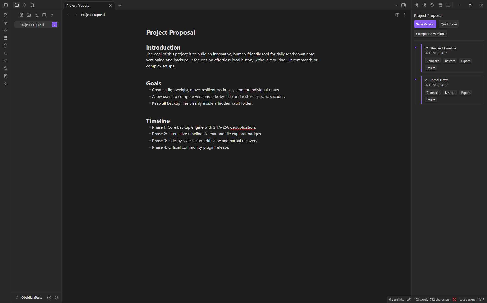
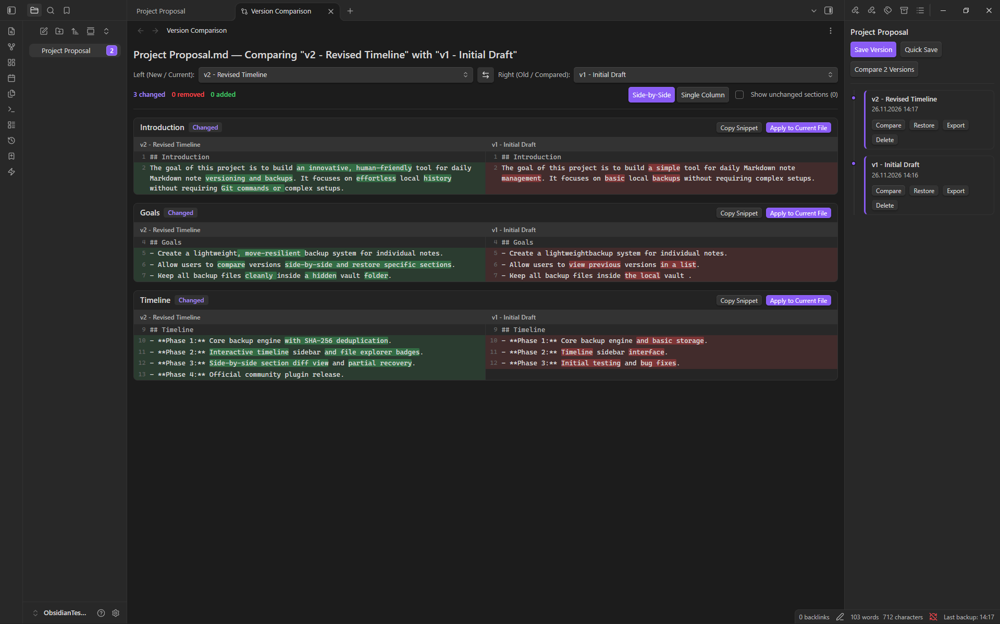

English | [Türkçe (Tam Dokümantasyon)](https://github.com/senteze/metin-giti/blob/master/README.tr.md)

<details>
<summary><b>🇹🇷 Türkçe Özet & Hızlı Başlangıç (Okumak için tıklayın)</b></summary>

### Metin Giti Nedir?
**Metin Giti**, Obsidian'daki Markdown (`.md`) notlarınız için geliştirilmiş; `commit`, `branch`, `merge` gibi karmaşık Git kavramları olmadan çalışan, tamamen insan odaklı bir sürüm geçmişi eklentisidir.

### Öne Çıkan Özellikler
- **Tek Tıkla veya İsimlendirerek Kaydetme:** Sol şeritten veya komut paletinden **Hızlı Sürüm Kaydet** ile anında yedek alın ya da özel isim ve açıklamayla sürüm oluşturun.
- **Akıllı Otomatik Yedekleme:** Arka planda sessizce yedek alır, birebir aynı içerikleri tekrar kaydetmez ve dosya taşınsa/yeniden adlandırılsa bile takibi korur.
- **Zaman Çizelgesi Paneli:** Notlarınızın tüm sürümlerini kronolojik sırada görün; tek tıkla **Eski Haline Dön**, **Dışa Aktar** veya **Sil** işlemlerini yapın.
- **Yan Yana Karşılaştırma ve Parçalı Geri Kazanım:** İki sürümü veya eski bir sürümü güncel halinizle başlık başlık yan yana karşılaştırın; sadece istediğiniz bölümü kopyalayın ya da güncel notunuza aktarın.
- **Dosya Gezgini Rozetleri ve Güvenli Silme:** Geçmişi olan notların yanında sürüm sayısını görün; bir notu sildiğinizde geçmişini koruyup korumayacağınıza siz karar verin.
- **Türkçe ve İngilizce Arayüz:** Obsidian dilinize otomatik uyum sağlar; notlarınızın içeriğine veya YAML üst verisine dokunmaz.

### Hızlı Kurulum
1. Obsidian'da **Ayarlar → Topluluk eklentileri → Göz at** yolunu izleyin.
2. **Metin Giti** yazıp arayın, **Yükle** ve ardından **Etkinleştir** butonuna tıklayın.

### Geri Bildirim & İletişim (Türkçe veya İngilizce)
- **Hata Bildirimi:** [Yeni Hata Bildirimi Aç](https://github.com/senteze/metin-giti/issues/new?template=bug_report.md)
- **Özellik Önerisi:** [Yeni Özellik Öner](https://github.com/senteze/metin-giti/issues/new?template=feature_request.md)
- **Sorular & Tartışmalar:** [GitHub Discussions](https://github.com/senteze/metin-giti/discussions)

</details>

# Metin Giti

**Metin Giti** is a human-friendly, linear version history plugin for individual Markdown (`.md`) notes in Obsidian—designed without technical Git concepts like `commit`, `branch`, or `merge`.

## Key Features

- **Quick & Manual Version Saving**
  - Save a snapshot in one click using **Quick Save** (from the ribbon or command palette), or add a custom label and description with **Save Version**.
  - Choose how versions are named automatically per note: sequential numbers (`v1, v2, v3...`) or date and time (`DD.MM.YYYY HH:mm`).

- **Smart Auto-Backup & Move-Resilient Tracking**
  - Runs quietly in the background with a configurable wait time and a subtle status bar indicator.
  - Automatically skips identical content so your history stays clean, keeps up to 30 auto-backups per note, and never deletes your manual versions.
  - Protects against unnecessary backups when you restore an older version.
  - Covers **All files** or **Tracked files only** with easy vault path suggestions, status indicators, and a **Test** button—and keeps tracking your notes even if you rename or move them.

- **Linear Timeline Sidebar**
  - View all saved versions in reverse chronological order with labels, timestamps, and descriptions.
  - Groups consecutive auto-backups into clean, expandable sections to avoid clutter.
  - Supports **Restore** (automatically creates a safety backup if your current note has unsaved changes), **Export** (saves a separate `.md` copy in the same folder), and **Delete** (with confirmation).

- **Side-by-Side Comparison & Section Recovery**
  - Compares any two versions—or an older version against your **Current Version**—heading by heading in **Side-by-Side** or **Single Column** view.
  - Highlights word-level changes, lets you hide unchanged sections, swap sides in one click, or pick any two versions directly from the timeline.
  - Recover just the parts you need using **Copy Snippet** or **Apply to Current File**.

- **File Explorer Badges & Safe Deletion**
  - Shows live version count badges next to `.md` notes in the file explorer (click a badge to open that note's timeline) and shield icons on protected folders.
  - Asks whether to **Keep History** or **Delete History** whenever you delete a note that has saved versions.

- **Bilingual Interface (EN / TR) & Clean Storage**
  - Adapts automatically to Obsidian's language or can be switched manually in **Settings → Metin Giti** (`Auto`, `English`, `Türkçe`).
  - Never touches your notes' YAML frontmatter. Stores all version data neatly in a hidden `.metin-giti/` folder at the root of your vault on both desktop and mobile.

## Screenshots

| Version Timeline | Side-by-Side Comparison |
| :---: | :---: |
|  |  |

## Installation

### Obsidian Community Plugins (Recommended)

1. Open **Settings → Community plugins** in Obsidian.
2. Select **Browse** and search for **Metin Giti**.
3. Select **Install**, then **Enable**.

<details>
<summary><b>Manual Installation & Developer Setup</b></summary>

#### Manual Installation

1. Download `main.js`, `manifest.json`, and `styles.css` from the latest release.
2. Copy them into `<YourVault>/.obsidian/plugins/metin-giti/`.
3. Open **Settings → Community plugins** in Obsidian and enable **Metin Giti**.

#### Developer Setup

```bash
npm install
npm run build
```

</details>

## Feedback, Bug Reports & Feature Requests

You can reach out in **English or Turkish**:

- **Bug Report:** [Open a Bug Report](https://github.com/senteze/metin-giti/issues/new?template=bug_report.md)
- **Feature Request:** [Request a Feature](https://github.com/senteze/metin-giti/issues/new?template=feature_request.md)
- **Questions & Ideas:** [Join GitHub Discussions](https://github.com/senteze/metin-giti/discussions)

## License

This plugin is licensed under the [0-BSD](LICENSE) license.
