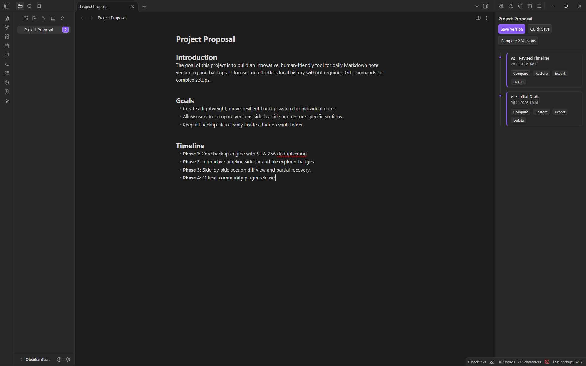
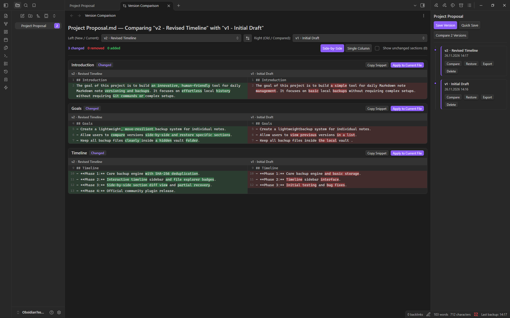

[English](https://github.com/senteze/metin-giti/blob/main/README.md) | **Türkçe**

# Metin Giti

**Metin Giti**, Obsidian içindeki tekil Markdown (`.md`) notları için geliştirilmiş; `commit`, `branch`, `merge` gibi teknik Git karmaşası olmadan çalışan, tamamen insan odaklı doğrusal sürüm geçmişi eklentisidir.

## Temel Özellikler

- **Hızlı ve Manuel Sürüm Kaydetme**
  - Sol şerit (ribbon) veya komut paleti üzerinden pencere açmadan tek tıkla **Hızlı Sürüm Kaydet** ile yedek alın ya da özel isim ve açıklamayla **Sürüm Kaydet** kullanın.
  - Not bazında otomatik isimlendirme tercihi seçin: sıralı numara (`v1, v2, v3...`) veya tarih ve saat (`GG.AA.YYYY SS:DD`).

- **Akıllı Otomatik Yedekleme ve Taşınmaya Dayanıklı Takip**
  - Ayarlanabilir bekleme süresiyle arka planda sessizce çalışır ve durum çubuğunda bilgi gösterir.
  - Birebir aynı içerikleri tekrar kaydetmez; not başına en fazla 30 otomatik yedek saklar ve manuel kayıtlarınızı asla otomatik silmez.
  - Eski bir sürüme döndüğünüzde gereksiz otomatik yedek oluşmasını engeller.
  - **Tüm dosyalar** veya **Sadece takip edilen dosyalar** modunda kolay yol önerileri, durum göstergeleri ve **Test Et** butonu sunar; notlarınızı taşısanız veya yeniden adlandırsanız bile takibi korur.

- **Doğrusal Zaman Çizelgesi Paneli**
  - Kaydedilen tüm sürümleri en yeni en üstte olacak şekilde sürüm adı, tarih-saat ve açıklamasıyla listeler.
  - Aradaki otomatik yedekleri katlanabilir gruplar halinde toplayarak görsel kalabalığı önler.
  - **Eski Haline Dön** (mevcut notunuzda kaydedilmemiş değişiklik varsa önce güvenlik yedeği alır), **Dışa Aktar** (aynı klasöre ayrı bir `.md` kopyası oluşturur) ve **Sil** (onay penceresiyle) seçenekleri sunar.

- **Yan Yana Karşılaştırma ve Parçalı Geri Kazanım**
  - Herhangi iki sürümü veya eski bir sürümü **Güncel Hal** ile başlık başlık **Yan Yana** ya da **Tek Sütun** görünümünde karşılaştırır.
  - Kelime bazlı değişiklikleri vurgular, değişmeyen bölümleri gizlemenize, tarafları tek tıkla değiştirmenize ve zaman çizelgesinden doğrudan 2 sürüm seçmenize olanak tanır.
  - **Parçayı Kopyala** ve **Güncel Dosyaya Al** butonlarıyla sadece istediğiniz bölümleri geri kazanın.

- **Dosya Gezgini Rozetleri ve Güvenli Silme**
  - Dosya gezgininde sürüm geçmişi bulunan `.md` notlarının yanında canlı sürüm sayısı rozeti (tıklandığında notun zaman çizelgesini açar) ve korunan klasörlerde kalkan ikonu gösterir.
  - Geçmişi olan bir notu sildiğinizde **Geçmişi Koru** veya **Geçmişi de Sil** seçeneği sunar.

- **Çift Dilli Arayüz (TR / EN) ve Temiz Depolama**
  - Obsidian dilinize otomatik uyum sağlar veya **Ayarlar → Metin Giti** üzerinden (`Otomatik`, `Türkçe`, `English`) elle seçilebilir.
  - Notlarınızın YAML üst verisine dokunmaz. Tüm sürüm verilerini masaüstü ve mobilde kasa kökündeki gizli `.metin-giti/` klasöründe düzenli şekilde saklar.

## Ekran Görüntüleri

| Zaman Çizelgesi | Yan Yana Karşılaştırma |
| :---: | :---: |
|  |  |

## Kurulum

### Obsidian Topluluk Eklentileri (Önerilen)

1. Obsidian'da **Ayarlar → Topluluk eklentileri** bölümünü açın.
2. **Göz at** butonuna tıklayıp **Metin Giti** eklentisini arayın.
3. **Yükle** ve ardından **Etkinleştir** butonuna tıklayın.

<details>
<summary><b>Manuel Kurulum ve Geliştirici Kurulumu</b></summary>

#### Manuel Kurulum

1. Son sürümden `main.js`, `manifest.json` ve `styles.css` dosyalarını indirin.
2. Bu dosyaları `<Kasanız>/.obsidian/plugins/metin-giti/` klasörüne kopyalayın.
3. Obsidian'da **Ayarlar → Topluluk eklentileri** bölümünden **Metin Giti** eklentisini etkinleştirin.

#### Geliştirici Kurulumu

```bash
npm install
npm run build
```

</details>

## Geri Bildirim, Hata Bildirimi ve Özellik Önerileri

Bize **Türkçe veya İngilizce** olarak ulaşabilirsiniz:

- **Hata Bildirimi:** [Hata Bildirimi Oluştur](https://github.com/senteze/metin-giti/issues/new?template=bug_report.md)
- **Özellik Önerisi:** [Özellik Önerisi Oluştur](https://github.com/senteze/metin-giti/issues/new?template=feature_request.md)
- **Sorular ve Fikirler:** [GitHub Discussions'a Katıl](https://github.com/senteze/metin-giti/discussions)

## Lisans

Bu eklenti [0-BSD](LICENSE) lisansı ile lisanslanmıştır.
